# 💰 Expense Tracker App using Data Science

An end-to-end, beginner-friendly data science project that generates synthetic personal-finance
data, cleans it, analyses spending behaviour, detects overspending and anomalies, and presents
everything in charts and an interactive **Streamlit** dashboard.

> Built with synthetic data (no real bank data needed) so it is safe to publish on GitHub.

## Problem
Raw transaction logs (bank statements, UPI history, receipts) are messy and hard to read. People
and small businesses cannot see where money goes, when they overspend, or whether they are saving enough.

## Solution
A reproducible pipeline: **data input → cleaning → analysis → visualisation → insights → decisions**.

## Features
- Synthetic one-year dataset with realistic patterns (salary, rent, festive shopping, summer electricity bills, weekend spikes) and deliberately messy rows
- Data cleaning: duplicates, text amounts ("Rs 1,200"), missing values, bad dates, inconsistent category names and aliases
- Category, monthly, weekday and payment-method analysis
- Savings-rate tracking against a 20% target
- **Overspending detection** against monthly category budgets
- **Anomaly detection** (per-category z-score) for unusually large transactions
- Simple next-month expense forecast (3-month average + linear trend)
- 9 saved charts and an auto-written insights report
- Streamlit dashboard with filters, budget alerts, and a form to add your own expenses
- Optional ESP32 button logger (`hardware/`)

## Tech stack
Python 3.10+, Pandas, NumPy, Matplotlib, Seaborn, Streamlit

## Project structure
```
Expense-Tracker-App/
├── data/        raw_expenses.csv, cleaned_expenses.csv
├── notebooks/   optional exploration notebooks
├── src/         config, generate_data, clean_data, analysis, visualize, insights
├── outputs/     summary CSVs and insights_report.md
├── images/      saved charts (used below)
├── hardware/    optional ESP32 sketch
├── docs/        PROJECT_GUIDE.md (full walkthrough, interview prep, troubleshooting)
├── app.py       Streamlit dashboard
├── main.py      runs the full pipeline
└── requirements.txt
```

## How to run
```bash
git clone https://github.com/arppitha-ai/Expense-Tracker-App.git
cd Expense-Tracker-App
python3 -m venv venv
source venv/bin/activate          # Windows: venv\Scripts\activate
pip install -r requirements.txt
python main.py --regen            # builds data, charts, reports
streamlit run app.py              # opens the dashboard
```

## Results (synthetic data, year 2025)
| Metric | Value |
|---|---|
| Total income | Rs 634,500 |
| Total expense | Rs 426,420 |
| Savings rate | 32.8% |
| Budget overruns | 25 (Shopping worst: 7 months) |
| Anomalies flagged | 11 (largest: laptop repair Rs 18,500) |

Months below the 20% savings target: August (laptop repair) and October (Diwali shopping).

## Screenshots
| | |
|---|---|
| 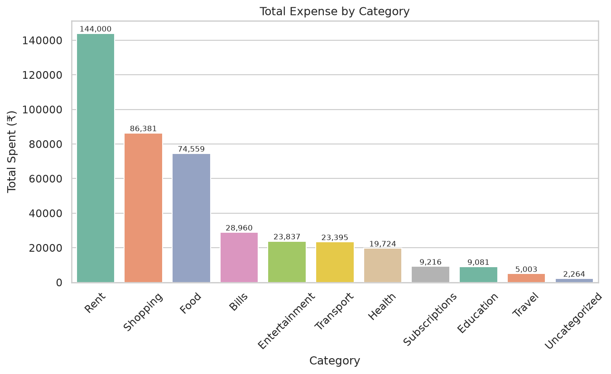 | 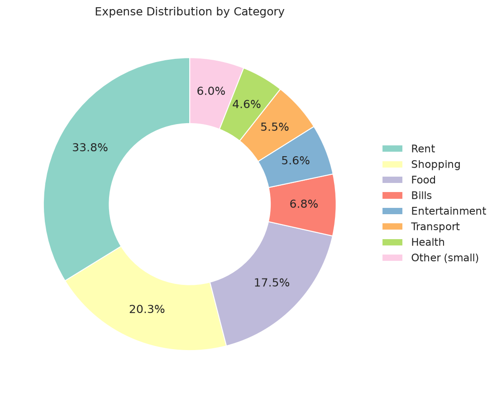 |
| 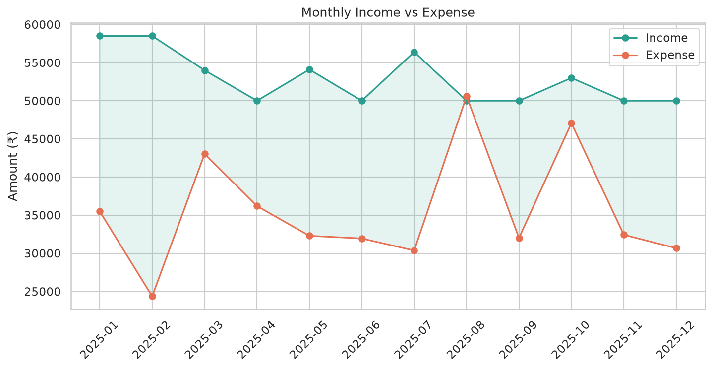 | 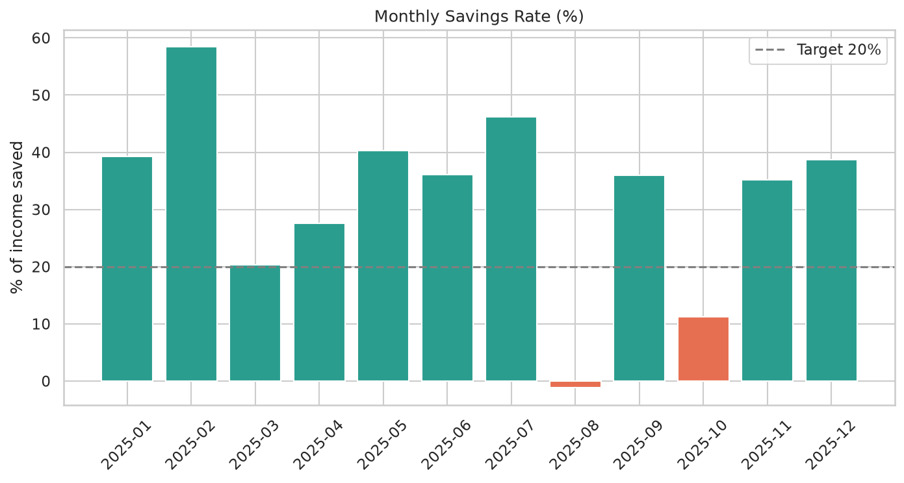 |
| 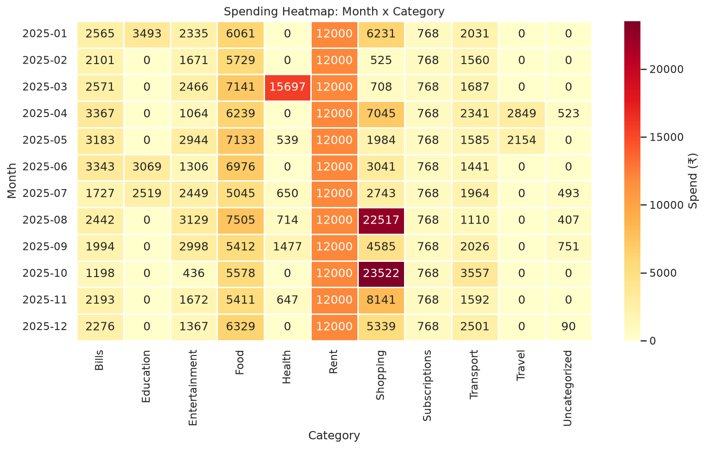 | 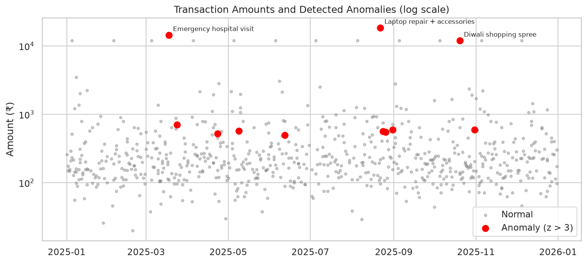 |

### Dashboard
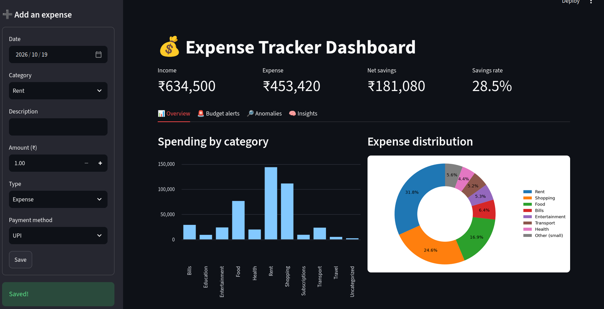
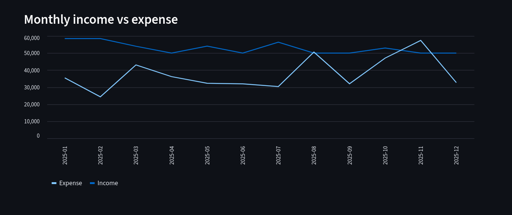
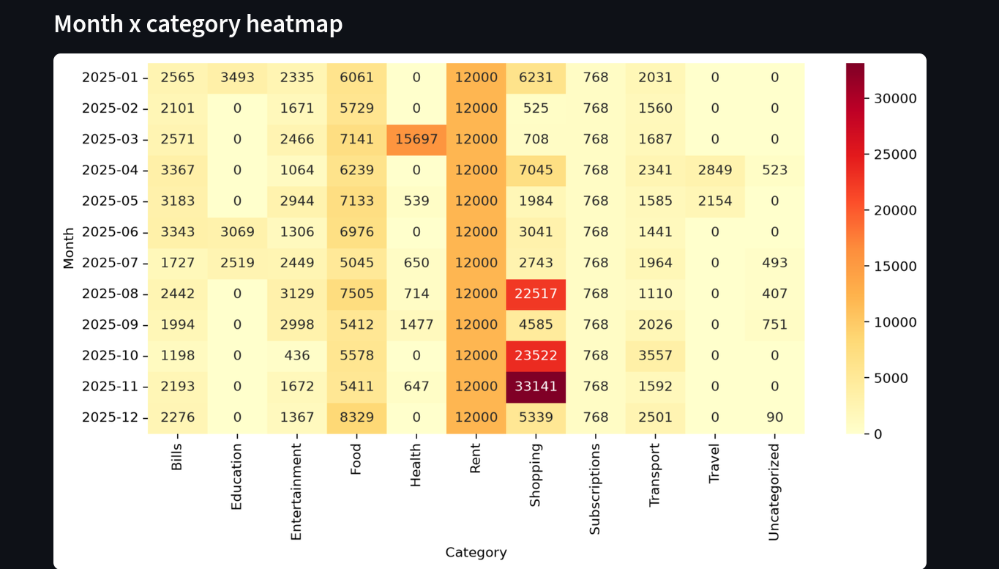
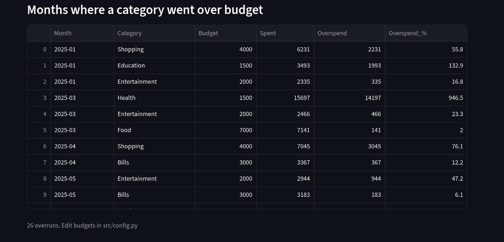
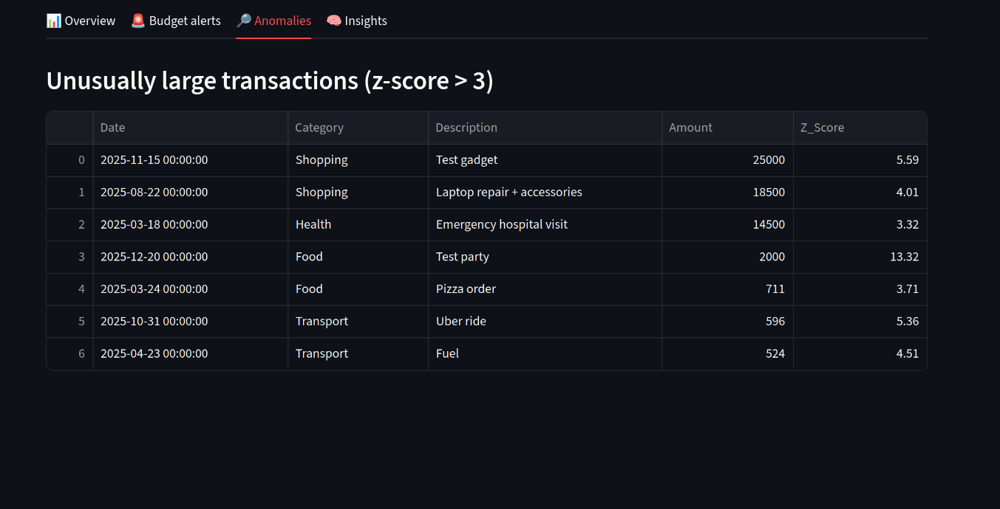
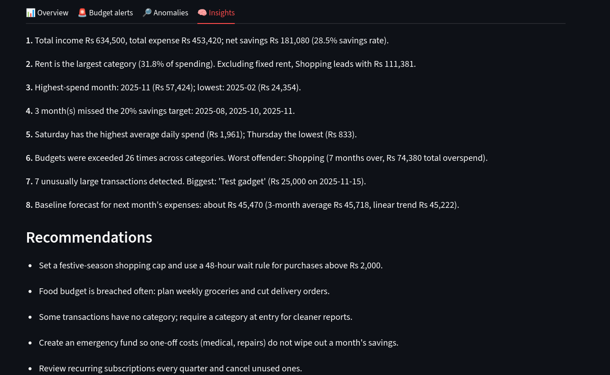

## Future improvements
Mobile app, real-time tracking (UPI/bank APIs), ML spending prediction (Prophet/ARIMA), budget alerts by email/SMS, savings-goal tracking.

## Author
Arppitha R A
